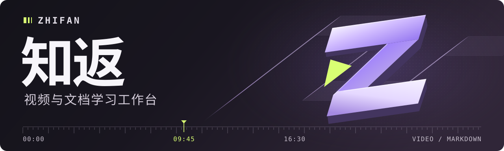
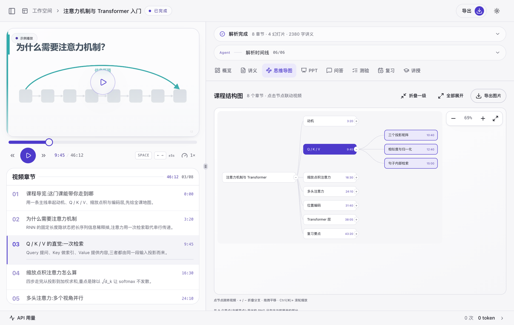
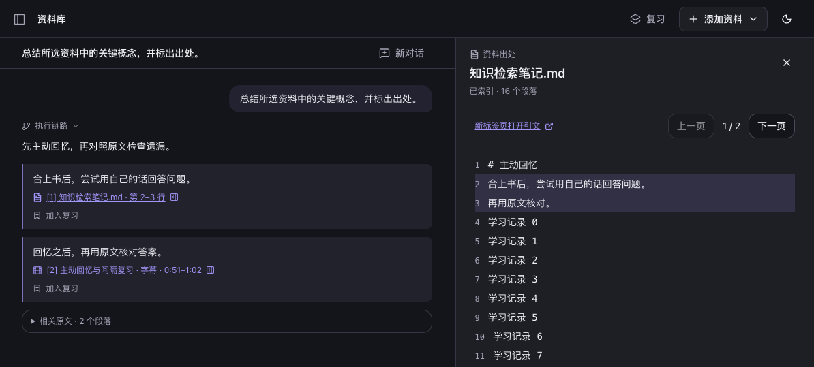

# 

**知返（VideoParse）** 把课程视频和 Markdown 笔记放进同一个可提问的资料库。问一句「老师怎么用检索来解释注意力机制？」，就能从回答跳回视频里的那个例子，或打开笔记中对应的几行原文。值得再想一次的问题，可以连同引文一起存成复习卡。

[看界面](#工作台预览) · [快速开始](#快速开始) · [模型与 API](#模型与-api) · [架构](#架构) · [贡献](#参与贡献)

## 工作台预览



*内置示例《注意力机制与 Transformer 入门》。右侧的 Q / K / V 节点和左侧第三章都指向 09:45。点任意一处即可回到这一节的开头。*

### 从视频做讲义

上传视频或导入公开的 B 站视频链接。知返按语音和画面划分章节，整理出带时间戳的图文讲义、课件关键帧和思维导图。分片上传支持续传，解析进度可以实时查看。读完后，可以把讲义打印为 PDF，或导出当前展开的思维导图 PNG。

### 从回答回到出处

上传 Markdown，或把笔记直接粘进资料库。提问时可以查全部资料，也可以限定到一份视频或文档。默认的「仅用资料库」模式会从所选材料中找依据，服务端逐字核对引用。点开一条引文，就能并排看答案和原文，或回到视频里对应的字幕与画面。



*资料库分栏实拍，使用演示数据。回答里的两条出处分别指向笔记第 2–3 行和视频 00:51–01:02。*

### 从引文开始复习

在引用下点「加入复习」，视频片段和文档段落会进入同一队列。复习时先回忆，再揭开引文核对。「还没记住」会在 10 分钟后再出现。连续记住的卡片逐步延长到 1、3、7、14、30 天。需要系统练习时，还可以从课程生成测验、按薄弱点安排复习、用笔记进行模拟面试，或按课时生成备课方案。[学习与备课指南](docs/platform-migration.md#从上传到学习)

## 快速开始

完整工作台使用 Python 3、Docker、BuildKit 和 Docker Compose v2.22 或更高版本。首次构建需要联网下载镜像和依赖。

**1. 克隆仓库，生成本地配置。** 配置生成命令只需在首次安装时执行。

```bash
git clone https://github.com/Vawet/VideoParse.git
cd VideoParse
python3 infra/platform/configure.py
```

**2. 编辑 `infra/platform/.env`。** 本机通过 HTTP 登录时，设置 `SESSION_COOKIE_SECURE=false`。上传视频时使用生成的 `UPLOAD_ANSWER` 作为上传口令。内置示例可以直接体验，需要解析自己的资料时，按下节填写模型配置。

**3. 启动平台。** 在仓库根目录运行以下命令。

```bash
docker compose --env-file infra/platform/.env -f infra/platform/compose.yaml up --build -d
```

打开[本机工作台](http://localhost:8088)即可浏览示例课程。登录后，进入[资料问答与复习](http://localhost:8088/library)添加自己的材料。公开部署使用 HTTPS，并启用安全会话 Cookie。[完整部署、停止与迁移说明](docs/platform-migration.md#本机启动)

## 模型与 API

平台从 **`infra/platform/.env`** 读取模型配置。保存修改后，重新执行上面的 Compose 启动命令即可应用。独立运行 Flask 开发版时，模型配置放在 `后端/.env`。

- **视频讲义、资料库回答和学习工具**可以选千问或 DeepSeek。使用千问时填写 `LLM_PROVIDER=dashscope` 和 `DASHSCOPE_API_KEY`，使用 DeepSeek 时填写 `LLM_PROVIDER=deepseek` 和 `DEEPSEEK_API_KEY`。
- **Java 侧的单视频证据问答与解析修复**单独读取 `PLATFORM_AI_KEY`、`PLATFORM_AI_URL` 和 `PLATFORM_AI_MODEL`。向量检索支持本地嵌入，也支持配置远程嵌入服务。[模型配置说明](docs/platform-migration.md#模型和费用)
- **调用记录**可在工作台底部的「API 用量」查看，每 5 秒刷新。展开可查调用来源、模型、输入与输出 token，以及缺少回执的记录。后台索引和自动重试也会各自记账。Brave Search 的费用默认按每次成功请求 0.005 美元估算，可用 `BRAVE_USD_PER_REQUEST` 调整单价。[Brave Search 定价](https://brave.com/search/api/)

本机平台的 HTTP 入口是 `http://localhost:8088/api`。可以先用健康检查确认服务已就绪。

```bash
curl http://localhost:8088/api/health
```

登录后，工作台通过 `GET /api/v2/library` 列出当前账号的资料。统一问答入口是 `POST /api/v2/library/chat`，响应以 NDJSON 逐行返回检索进度和最终答案。下面的例子可以直接在已登录的工作台浏览器控制台运行。

```javascript
const response = await fetch("/api/v2/library/chat", {
  method: "POST",
  headers: { "Content-Type": "application/json" },
  body: JSON.stringify({
    question: "视频和笔记分别是怎样解释注意力机制的？",
    kind: "all",
    libraryOnly: true
  })
});
console.log(await response.text());
```

## 架构

- **工作台**使用 React 和 TypeScript。视频解析任务通过 SSE 推送进度，资料对话在回答旁打开对应的播放器或原文阅读器。[前端源码](前端/workspace/src)
- **平台服务**使用 Java 21 和 Spring Boot 3.5，负责账号、上传、任务编排和引用校验。MySQL 记录任务与学习进度，RocketMQ 通知后台执行。MinIO 保存上传对象，工作卷保存媒体处理产物，Neo4j 保存已发布的解析快照。[平台源码](platform/src/main/java/org/videoparse) · [发布与恢复机制](docs/platform-migration.md#消息队列与图发布恢复)
- **媒体与学习工具**由 Python 执行，复用 FFmpeg、Whisper、OCR 和模型服务。文档按标题与原文行切段，支持全文和可选的 Qdrant 向量检索。跨资料库查视频时，使用带时间位置的中文全文索引，再将结果与文档候选一起排序。[Python 工具](后端/app) · [检索与存储设计](docs/retrieval-storage-decision.md)

## 参与贡献

在已安装后端开发依赖的环境中，可以先跑一组离线回归。下面的用例覆盖 Agent 的工具选择和结果校验，按改动范围选择其他测试。

```bash
cd 后端
python -m pytest app/tests/test_agent_offline.py -q
```

欢迎用 Issue 报告问题或讨论想法。涉及定位误差时，附上脱敏的问题、预期时间戳或行号，会更容易复现。提交 PR 时，请说明改动影响的入口和你验证过的行为。[提交 Issue](https://github.com/Vawet/VideoParse/issues) · [Pull Requests](https://github.com/Vawet/VideoParse/pulls) · [开发约定](CLAUDE.md)

项目起源于 **2025 腾讯犀牛鸟开源人才培养计划**的「视频生成图文混排讲义工具」。仓库名沿用 VideoParse。[项目图标](docs/assets/zhifan/mark.svg)
